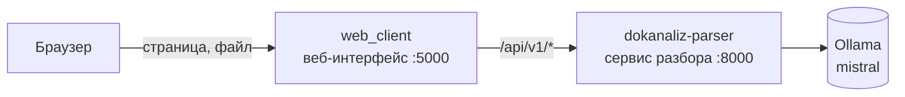

# ДокАнализ — веб-интерфейс

Веб-интерфейс системы обработки финансовых документов. Две отдельные страницы:

- **Разбор** (`/parse`, она же `/`) — загрузка документов и запуск разбора:
  каждый файл получает ID разбора, видны статус, ссылка на просмотр, сырой и
  итоговый JSON; там же история всех разборов.
- **Просмотр** (`/view?id=<ID>`) — один конкретный разбор: документ с
  подсветкой значений прямо на своём месте, связи подписей со значениями.
  Просмотр атомарный: ему нужен только ID, своей шапки и навигации у него нет.
  На странице разбора он открывается во фрейме поверх списка, а встроить его
  можно куда угодно: `<iframe src="http://localhost:5000/view?id=<ID>"></iframe>`.

Сам интерфейс ничего не распознаёт. Разбор выполняет отдельный сервис —
репозиторий [dokanaliz-parser](https://github.com/reyni300/dokanaliz-parser).
Интерфейс общается с ним только через API:
[формат API и результата](https://github.com/reyni300/dokanaliz-parser/blob/main/docs/parser_api.md).



## Как пользоваться

1. На странице разбора загрузить документы и нажать «Запустить разбор».
   Каждый файл сразу получает **ID разбора**, документ распознаётся в фоне.
2. «▣ Просмотр» открывает просмотр этого разбора во фрейме: каждое значение
   обведено на своём месте в документе. «↗ В новой вкладке» — отдельной вкладкой.
3. Любой разбор открывается во фрейме: «Просмотр» в шапке — вставить ID или
   ссылку, либо из истории, либо адресом `http://localhost:5000/parse?open=<ID>`.
   Отдельной страницей — `http://localhost:5000/view?id=<ID>`; старые ссылки
   `/?id=<ID>` ведут туда же.
4. **Ссылка на блок.** Щелчок по блоку на листе закрепляет его (остальное
   приглушается), над документом появляется его ID и «🔗 Ссылка на блок».
   Ссылка `…/view?id=<ID>&block=<ID блока>` открывает разбор на нужной
   странице с выделенным блоком. Второй щелчок по закреплённому блоку
   выбирает в нём слово — «🔗 Ссылка на слово» (`p1-b42-w2`). ID берётся из
   любого JSON: `p1-b42`, `p1-b42-w2` — итоговый, `p1-r3`, `p1-r3-l2`,
   `p1-r3-l2-w5` — сырой. Esc или ✕ снимают выделение: сначала слово, потом блок.
5. Переключатели над листами («Связанные значения», «Оригинал», «Подсветка»,
   «Фон справа», «Весь текст») показывают состояние ползунком и надписью
   «вкл/выкл» и закреплены при прокрутке. «Связанные значения» при каждом
   открытии выключены.

## Встраивание просмотра в другую страницу

`embed-example/index.html` — пример внешней страницы: один файл на чистых HTML
и JavaScript, без библиотек и без кода ДокАнализа. Открывается прямо с диска.
Вводишь ID разбора или ссылку на него — просмотр открывается у этой страницы
во фрейме. Адрес сервиса по умолчанию `http://localhost:5000`; если вставить
ссылку целиком, адрес берётся из неё. Можно и сразу:
`index.html?id=<ID>&service=http://localhost:5000`.

Встроить просмотр в свою страницу можно и одной строкой:

```html
<iframe src="http://localhost:5000/view?id=<ID разбора>"></iframe>
```

## Разборы на GitHub Pages (без сервиса)

`tools/export_static.py` выгружает готовые разборы в папку-сайт, которую можно
выложить на GitHub Pages: просмотр там работает без запущенного сервиса.

```bash
python3 tools/export_static.py tools/smartpartner.csv --files ~/smartpartner
```

- `tools/smartpartner.csv` — список разборов: `year,quarter,document,id`;
- в папке `dokanaliz-demo`: `index.html` (простая страница), `view.html`
  (просмотр), `<ID>.json` (результат как есть), `raw/<ID>.json` (сырой JSON),
  `pages/<ID>/page-N.jpg` (картинки страниц в JPEG — PNG со скана слишком тяжёлый для GitHub), `files/` (оригиналы) и `board.tsv` — строки со
  ссылками для таблицы `year | quarter | file | json | preview`;
- `…/dokanaliz-demo/?id=<ID>` — простая страница сразу открывает preview;
  разбор она берёт из `<ID>.json` рядом с собой.

Режим «из файлов» включается флагом `STATIC_DATA` в `view.html` и
`embed-example/index.html`; в самом приложении он выключен.

## Запуск

Оба репозитория должны лежать рядом в одной папке:

```bash
cd ~
git clone https://github.com/reyni300/document-classification-system.git
git clone https://github.com/reyni300/dokanaliz-parser.git
mkdir -p dokanaliz-parser/data/parses

cd document-classification-system
docker compose up --build
```

- Веб-интерфейс: http://localhost:5000
- API сервиса разбора: http://localhost:8000/api/v1/health

Нужен запущенный Ollama с моделью `mistral` на порту 11434.

## Тесты

```bash
docker compose run --rm -v "$PWD":/app web python -m unittest discover -s tests -t .
```

## Структура

```
web_client/
  server.py          отдаёт страницы и пересылает /api/v1/* в сервис разбора
  static/parse.html  страница разбора: загрузка, статус, ID, история
  static/view.html   страница просмотра одного разбора с подсветкой
  static/common.js   общее: обращение к API, ожидание разбора, выгрузка JSON
  static/common.css  общее оформление обеих страниц
  Dockerfile
embed-example/     пример внешней страницы, встраивающей просмотр во фрейм
tools/             export_static.py — выгрузка разборов для GitHub Pages
tests/             тесты веб-интерфейса
docker-compose.yml запуск интерфейса вместе с сервисом разбора
```
