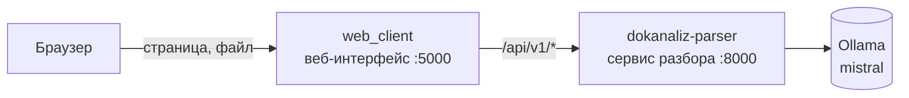

# ДокАнализ — веб-интерфейс

Веб-интерфейс системы обработки финансовых документов: загрузка документов,
просмотр результата с подсветкой значений прямо на странице документа,
история разборов, открытие результата по ID.

Сам интерфейс ничего не распознаёт. Разбор выполняет отдельный сервис —
репозиторий [dokanaliz-parser](https://github.com/reyni300/dokanaliz-parser).
Интерфейс общается с ним только через API:
[формат API и результата](https://github.com/reyni300/dokanaliz-parser/blob/main/docs/parser_api.md).



## Как пользоваться

1. Загрузить документы и нажать «Запустить анализ». Каждый файл сразу
   получает **ID разбора**, документ распознаётся в фоне.
2. Результат показывается с подсветкой: каждое значение обведено на своём
   месте в документе.
3. Любой готовый результат открывается по ID: поле «Открыть результат по ID»,
   ссылка вида `http://localhost:5000/?id=<ID>` или вкладка «История».

## Запуск

Оба репозитория должны лежать рядом в одной папке:

```bash
cd ~
git clone https://github.com/reyni300/document-classification-system.git
git clone https://github.com/reyni300/dokanaliz-parser.git
mkdir -p dokanaliz-parser/data/parses

cd document-classification-system
docker compose up --build
```

- Веб-интерфейс: http://localhost:5000
- API сервиса разбора: http://localhost:8000/api/v1/health

Нужен запущенный Ollama с моделью `mistral` на порту 11434.

## Тесты

```bash
docker compose run --rm -v "$PWD":/app web python -m unittest discover -s tests -t .
```

## Структура

```
web_client/
  server.py        отдаёт страницу и пересылает /api/v1/* в сервис разбора
  static/index.html  страница: загрузка, просмотр с подсветкой, история
  Dockerfile
tests/             тесты веб-интерфейса
docker-compose.yml запуск интерфейса вместе с сервисом разбора
```
