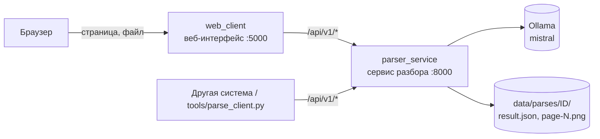

# ДокАнализ — система обработки финансовых документов

Распознаёт финансовые документы (бухгалтерский баланс по форме Минфина РБ
№ 104, чеки, банковские квитанции, счета), извлекает значения и отдаёт их
вместе с координатами на странице — для подсветки один в один с документом.

## Архитектура

Система разделена на два независимых сервиса:



- **parser_service** — слой разбора: OCR (Tesseract), модель (Ollama
  mistral), правила по координатам, поиск координат полей. Принимает файл,
  сразу отдаёт **ID разбора**, разбирает документ в фоне и хранит результат
  в `data/parses/<id>/`. О веб-интерфейсе ничего не знает.
- **web_client** — веб-интерфейс: загрузка, просмотр с подсветкой, история.
  Не импортирует ни одного модуля разбора — работает только через API.
  Страница, открытая как `http://localhost:5000/?id=<ID>`, сразу показывает
  результат этого разбора.

Договор между ними — [docs/parser_api.md](docs/parser_api.md): адреса API
и формат результата (поля, значения, источник, координаты).

## Запуск (Docker)

Нужен Docker с Compose и запущенный контейнер Ollama с моделью `mistral`
на порту 11434.

```bash
mkdir -p data/parses          # один раз: папка для результатов
docker compose up --build     # собрать и запустить оба сервиса
```

- Веб-интерфейс: http://localhost:5000
- API сервиса разбора: http://localhost:8000/api/v1/health

После правки кода — снова `docker compose up --build` (собирается за
секунды: зависимости берутся из кэша).

Если своего контейнера Ollama нет: `docker compose --profile ollama up`, затем
`docker compose exec ollama ollama pull mistral`.

## Проверка без браузера

Положите документ в папку `data/` (она видна контейнеру как `/app/data`):

```bash
docker compose exec parser python tools/parse_client.py submit data/баланс.pdf --wait
docker compose exec parser python tools/parse_client.py fields <ID>
```

Или с хоста, если стоит Python с `requests`:
`python tools/parse_client.py submit баланс.pdf --wait`.

## Тесты

```bash
docker compose run --rm -v "$PWD":/app parser python -m unittest discover -s tests -t . -v
```

Тестам не нужны ни модель, ни сеть: OCR и модель в них подменяются, а
оркестратор, правила, поиск координат, хранилище, очередь и API — настоящие.

## Структура

```
parser_service/     сервис разбора: API, очередь, хранилище, сборка результата
  api.py            HTTP API /api/v1
  pipeline.py       разбор документа: OCR → модель → правила → координаты
  field_locator.py  поиск OCR-блоков, на которых стоит значение поля
  result_schema.py  формат результата (schema_version)
  storage.py        data/parses/<id>/: исходник, статус, результат, страницы
  worker.py         очередь и фоновый обработчик (по одному документу)
web_client/         веб-интерфейс: страница + пересылка /api/v1 в сервис разбора
ocr/, llm/, agents/, orchestrator/, preprocessing/, translation/, rule_fields.py
                    модули распознавания (используются сервисом разбора)
tools/parse_client.py  консольный потребитель API
tests/              тесты
docs/parser_api.md  API и формат результата
```

Настольное приложение (`main.py`, `gui/`) по-прежнему работает напрямую с
оркестратором и SQLite.

## Технологии

**Frontend:** HTML + JavaScript (без фреймворков)
**Backend:** Flask (Python)
**OCR:** Tesseract (rus + eng), OpenCV
**LLM:** Ollama (mistral)
**Хранение результатов:** файлы JSON по ID разбора
